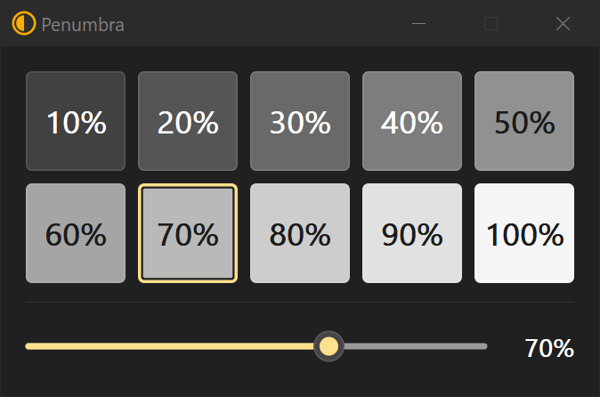

# Penumbra

It's late. Your screen is already at 0 % brightness, and it's still too much.
Penumbra simply takes it a little further down.



It scales the graphics card's colour table (gamma ramp) of every monitor, so
nothing sits over your windows and the mouse cursor dims too.

One native exe of about 198 KB: **0.8 MB of RAM** with the panel open, **0.5 MB** in the tray, no CPU while idle. For Windows 10 (2004+) and 11, x64.

## Install

Run **`Penumbra-1.0.0-x64.msi`** from
[Releases](https://github.com/MBach/penumbra/releases) (administrator rights
needed).

It installs in `C:\Program Files\Penumbra` with a Start menu shortcut,
and lets Windows accept colour tables below 50 % (`GdiIcmGammaRange`). Windows
reads that at startup, so the installer offers a restart when the setting is
new, and the uninstall removes it only if the installer added it.

It is not code-signed, so Windows asks three times: the browser may call the
file uncommon (_Keep_), SmartScreen warns (_More info_ > _Run anyway_), and the
admin prompt shows an unknown publisher (_Yes_).

Doesn't work where Windows ignores colour tables: HDR displays, Remote Desktop
sessions, some USB display adapters.

## Build

Needs Visual Studio 2022+ (or its Build Tools) with _Desktop development with
C++_; the MSI also needs the .NET SDK 8+ (the script fetches WiX on its own).

```bat
git clone https://github.com/MBach/penumbra.git
cd penumbra
build.cmd        :: build\Penumbra.exe
build-msi.cmd    :: build\Penumbra-<version>-x64.msi
```

The version lives in `src/penumbra.rc`; bump it before a release.

## License

[MIT](LICENSE) © 2026 Matthieu BACHELIER
